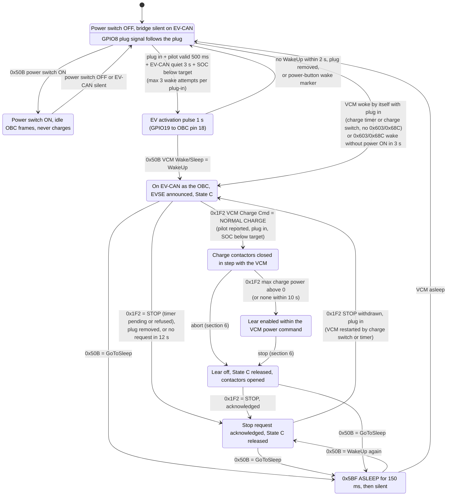
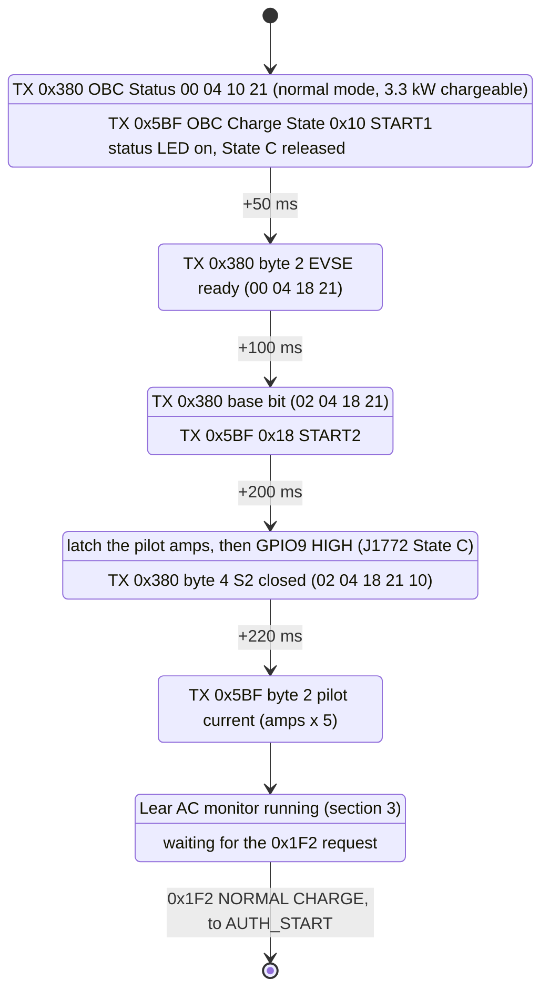
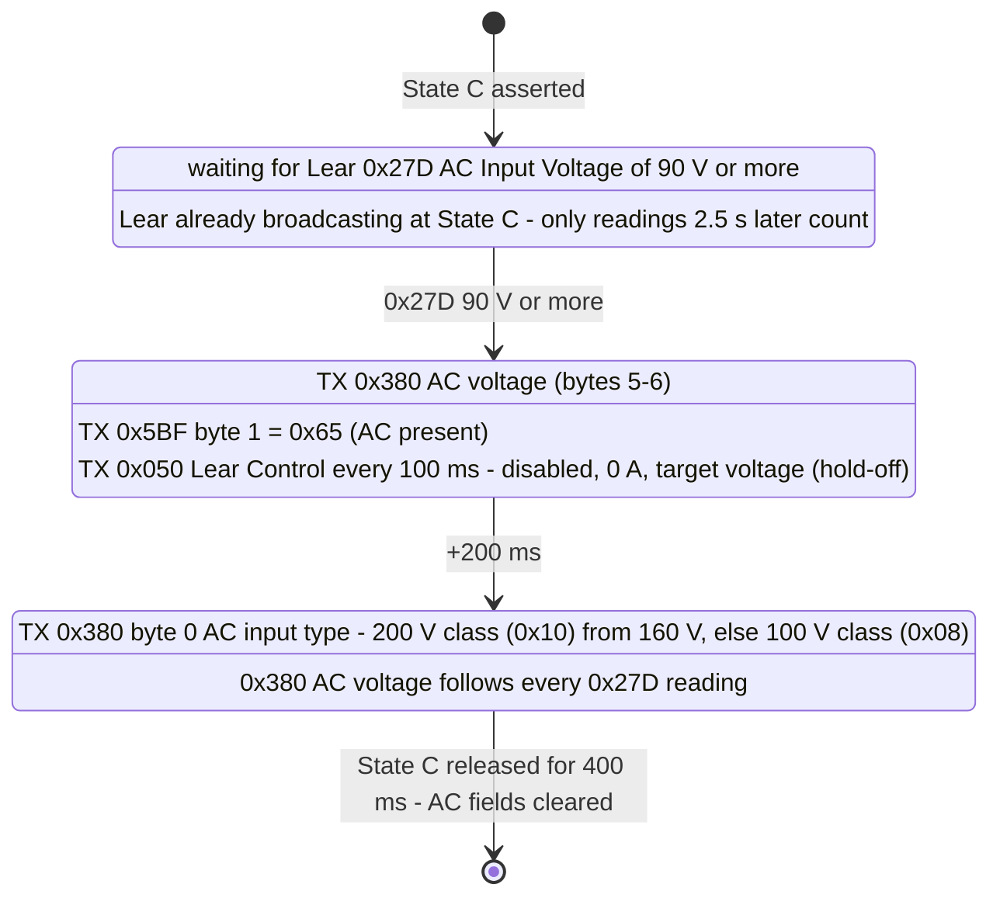
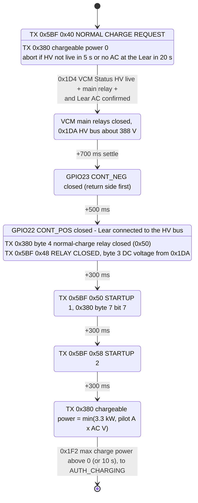
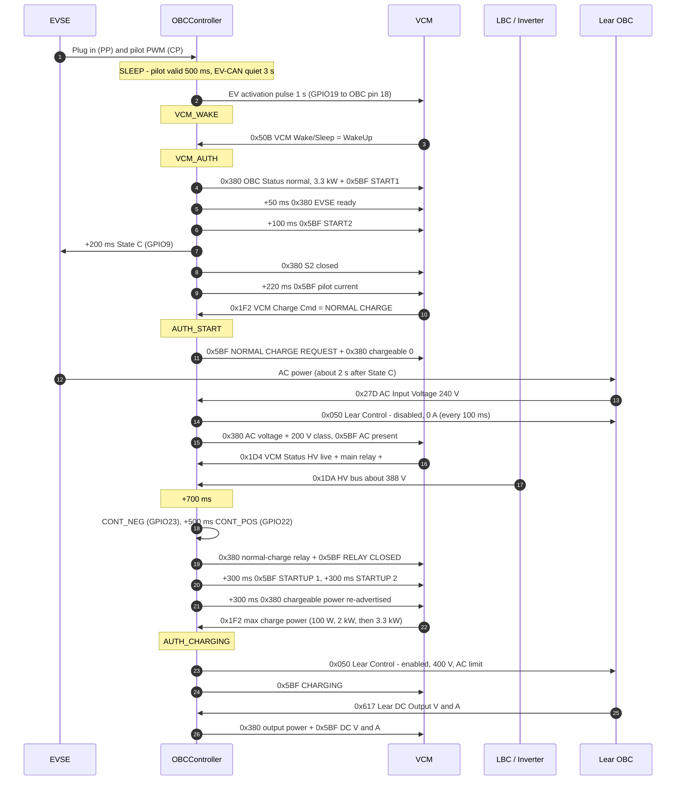

# Charge-start sequence (VCM-authorised)

How OBCController starts an AC charge, as implemented in [state_machine.c](firmware/main/state_machine.c), [sm_config.h](firmware/main/sm_config.h), [obc_frames.h](firmware/main/obc_frames.h) and [twai_handler.c](firmware/main/twai_handler.c) on 2026-11-02.

The VCM authorises a charge only with the power switch OFF. The bridge acts as the stock OBC:
1. It wakes the VCM.
2. It announces the EVSE.
3. It waits for the normal-charge request.
4. It closes the charge contactors once the VCM's main relays have made the HV bus live.
5. It enables the Lear within the VCM's power command.

Times are from [sm_config.h](firmware/main/sm_config.h). The state machine runs every 10 ms. `0x380`, `0x5BF` and `0x050` are sent every 100 ms.

## 1. Overview

**Transitions that apply in every state from `VCM_AUTH` onward:**
- EV-CAN silent for 500 ms: go to `SLEEP` and release every output.
- `0x50B` power switch ON: go to `POWER_ON`.

**EV-CAN transmit gate:** in these states, `0x380` and `0x5BF` go out only while a VCM frame (`0x50B`, `0x1F2` or `0x1D4`) arrived within the last 100 ms, and until GoToSleep has lasted 150 ms. In `SLEEP` and `VCM_WAKE` the bridge does not transmit on EV-CAN.

## 2. `VCM_AUTH`: appear and announce the EVSE

Each delay counts from entering `VCM_AUTH`. The announcement steps run only while the plug is in, the pilot is valid and the SOC is below the target.

- **Cold vs. warm entry:** after a wake (cold entry), `0x380` byte 0 is `00` for the first 100 ms, as the stock OBC sends it. On a VCM restart from `VCM_STANDBY` (warm entry) it is `02` from the start.
- **Pilot latch:** the pilot is latched just before State C because the CP circuit cannot be read once State C is asserted.
- **SOC reaches the target after State C:** the announcement is withdrawn. State C is released, EVSE ready is cleared and `0x050` stops. The VCM then times out and sends a stop request.

## 3. Lear AC monitor (every state, once State C is asserted)

The Lear broadcasts whenever it has 12 V, also without AC. AC therefore counts as present only from its measured AC input voltage.

AC usually arrives 1.2–2.3 s after State C, so it is often confirmed after the VCM's normal-charge request (during `AUTH_START`).

## 4. `AUTH_START`: contactors and power handshake

**On entering `AUTH_CHARGING`:**
- `0x050` is sent with ChargeEnable = 1. The target voltage is 400 V by default, adjustable on `0x6C0`.
- The AC current limit is the lowest of:
  - the pilot current;
  - 3300 W ÷ the measured AC voltage;
  - the `0x1F2` power command ÷ the measured AC voltage.
- `0x5BF` changes to `0x60` CHARGING.
- The bridge-initiated wake counter resets.

**In each 10 ms cycle while charging:**
- The Lear current limit is recomputed.
- `0x380` reports the output power (`0x617` DC V × A).
- `0x5BF` reports the DC voltage (`0x1DA`) and the DC current (`0x617`).

## 5. Successful start, step by step

Example: bridge-initiated wake, 240 V EVSE.

### Frame content by step

`0x380` columns are bytes 0–4. A dash means unchanged from the row above.

| # | State | Trigger | Bridge action | `0x380` OBC Status | `0x5BF` state (byte 4) | `0x050` Lear Control |
|---|---|---|---|---|---|---|
| 1 | `SLEEP` | Plug in, pilot > 0 A for 500 ms, EV-CAN quiet 3 s | Activation pulse, GPIO19 for 1 s | silent | silent | silent |
| 2 | `VCM_AUTH` | `0x50B` WakeUp | LED on | `00 04 10 21 00` | `0x10` START1 | silent |
| 3 | `VCM_AUTH` +50 ms | Plug in, pilot valid, SOC < target | — | `00 04 18 21 00` EVSE ready | — | — |
| 4 | `VCM_AUTH` +100 ms | — | — | `02 04 18 21 00` | `0x18` START2 | — |
| 5 | `VCM_AUTH` +200 ms | — | Latch pilot, State C (GPIO9) | `02 04 18 21 10` S2 | — | — |
| 6 | `VCM_AUTH` +220 ms | — | — | — | byte 2 = amps × 5 | — |
| 7 | `AUTH_START` | `0x1F2` request = `0x20` | — | `02 04 18 00 10` chargeable 0 | `0x40` | — |
| 8 | any, after State C | `0x27D` ≥ 90 V | Lear held off | bytes 5–6 AC voltage; +200 ms byte 0 `12` (200 V) / `0A` (100 V) | byte 1 = `0x65` | `00 DC 0F A0 00 00 00 00` |
| 9 | `AUTH_START` | `0x1D4` HV live + relay +, AC confirmed | Wait 700 ms, CONT_NEG (GPIO23) | — | — | — |
| 10 | `AUTH_START` +500 ms | — | CONT_POS (GPIO22) | byte 4 `50` relay closed | `0x48`; byte 3 DC V | — |
| 11 | `AUTH_START` +300 ms | — | — | byte 7 bit 7 | `0x50` | — |
| 12 | `AUTH_START` +300 ms | — | — | — | `0x58` | — |
| 13 | `AUTH_START` +300 ms | — | — | byte 3 = min(3.3 kW, pilot × AC V) | — | — |
| 14 | `AUTH_CHARGING` | `0x1F2` max charge power > 0, or 10 s | Lear enabled | output power in bytes 4–5 | `0x60`; byte 6 DC A | `00 DC 0F A0 00 LL LL 01` |

**Notes:**
- `LL LL` is the AC current limit in 0.1 A.
- `0F A0` is 400.0 V.
- Bytes 0, 4 and 6 of `0x050` are always `00`, and byte 1 is always `DC`.
- In row 13, a 120 V EVSE at 15 A gives 1.8 kW (`0x12`); a 240 V EVSE at 32 A is capped at 3.3 kW (`0x21`).

## 6. Abort and stop conditions

Every stop goes through `AUTH_STOP`. In `AUTH_STOP` the bridge:
1. Disables the Lear.
2. Releases State C once the output is below 1 A, or after 1 s.
3. Opens CONT_POS, then CONT_NEG 500 ms later, after the VCM opens its main relays (or after 8 s).
4. Sends `0x5BF 0x78`, then acknowledges the `0x1F2` stop request.

| Condition | `AUTH_START` | `AUTH_CHARGING` | `0x5BF` | Effect on further wakes |
|---|---|---|---|---|
| `0x1F2` request = STOP | yes | yes | `0x70` END OF CHARGE | From `AUTH_CHARGING`: none until unplug |
| `0x1F2` max charge power back to 0 | — | yes | `0x70` | None until unplug |
| `0x1D4` charge-session bit cleared | — | yes | `0x70` | None until unplug |
| Connector button or unplug | yes | yes | `0x80` OBC STOP | None until unplug |
| SOC ≥ target (`0x55B`), emulated release-switch press | — | yes | `0x80` | None until unplug; a later charge also needs SOC < target − 2 % |
| VCM asleep or EV-CAN silent | yes | yes | `0x80` | Fault |
| `0x1F2` lost for 500 ms | — | yes | `0x80` | Fault |
| LBC failsafe (`0x1DB`) | yes | yes | `0x80` | Fault |
| HV bus not live within 5 s | yes | — | `0x80` | Fault |
| HV bus lost (`0x1D4`) | yes, after the contactors | yes | `0x80` | Fault |
| No AC at the Lear within 20 s | yes | — | `0x80` | Fault |
| AC lost at the Lear (`0x27D`) | yes, after the HV-live step | yes | `0x80` | Fault |
| Lear silent for 2.5 s | — | yes | `0x80` | Fault |

- **Fault:** the bridge may wake the VCM again. After 3 fault stops in one plug-in it stops waking the VCM until the plug is removed.
- **VCM self-wakes:** "None until unplug" limits only bridge-initiated wakes. When the VCM wakes by itself (charge timer or charge switch), the bridge always answers.
- **0x80 → 0x70:** if the VCM follows an `0x80` stop with a stop request, `0x5BF` changes to `0x70`.

## 7. CAN messages

| ID | Bus | Dir | Name used here | Fields used |
|---|---|---|---|---|
| `0x50B` | EV-CAN | RX | VCM Wake/Sleep | byte 3 bits 7:6 WakeUp / GoToSleep; byte 2 ≠ 0 = power switch ON (stays 0 in a charge wake) |
| `0x603`, `0x68C` | EV-CAN | RX | Power-button wake marker | Sent about 40 ms before a power-button wake, never before a charge wake |
| `0x1F2` | EV-CAN | RX | VCM Charge Cmd | byte 2 & `0x60`: `0x20` NORMAL CHARGE, `0x60` STOP; byte 1 max charge power ((raw − 100) × 100 W); byte 5 VCM mode |
| `0x1D4` | EV-CAN | RX | VCM Status | byte 4 bit 2 HV live; byte 5 bit 6 main relay +; byte 6 bit 7 charge session |
| `0x1DA` | EV-CAN | RX | Inverter HV bus voltage | bytes 0–1, 10 bit × 0.5 V |
| `0x1DB` | EV-CAN | RX | LBC failsafe | byte 1 bits 2:0 ≠ 0 → stop |
| `0x55B` | EV-CAN | RX | LBC SOC | bytes 0–1, 0.1 % |
| `0x380` | EV-CAN | TX | OBC Status | Mode, EVSE ready, S2, relay, chargeable / output power, AC voltage and class, stop acknowledge |
| `0x5BF` | EV-CAN | TX | OBC Charge State | byte 4 state, byte 2 pilot amps × 5, byte 1 AC present, byte 3 DC V − 263, byte 6 DC A |
| `0x050` | Lear CAN | TX | Lear Control | ChargeEnable, AC current limit (0.1 A), target voltage (0.1 V) |
| `0x27D` | Lear CAN | RX | Lear AC Input Voltage | bytes 0–1 ÷ 32 = V |
| `0x617` | Lear CAN | RX | Lear DC Output | DC V and A (0.1 units) |
| `0x274`, `0x27D`, `0x616`–`0x618` | Lear CAN | RX | Lear alive | Any of these within 2.5 s |

## 8. Timing constants

| Constant | Value | Used for |
|---|---|---|
| `SM_PILOT_STABLE_MS` | 500 ms | Pilot valid before a wake |
| `SM_REWAKE_DELAY_MS` | 3 s | EV-CAN quiet before a (re)wake |
| `SM_EVA_PULSE_MS` | 1 s | Activation pulse |
| `SM_VCM_WAKE_TIMEOUT_MS` | 2 s | Wait for `0x50B` WakeUp |
| `SM_VCM_WAKE_ATTEMPTS` | 3 | Wakes, and fault stops, per plug-in |
| `SM_POWER_ON_WAIT_MS` | 3 s | Wait for power ON after a `0x603`/`0x68C` wake |
| `SM_ANNOUNCE_READY_MS` / `_S2_MS` / `_PILOT_MS` | 50 / 200 / 220 ms | EVSE ready, State C, pilot amps |
| `SM_CHARGE_REQ_TIMEOUT_MS` | 12 s | Wait for the `0x1F2` request (VCM's own limit is 10.24 s) |
| `SM_HV_LIVE_TIMEOUT_MS` | 5 s | HV live after the request |
| `SM_LEAR_AC_TIMEOUT_MS` | 20 s | AC at the Lear after the request |
| `SM_LEAR_AC_SETTLE_MS` | 2.5 s | Ignore early `0x27D` from a Lear left on from the last session |
| `SM_AC_PRESENT_MIN_V` / `SM_AC_200V_CLASS_MIN_V` | 90 V / 160 V | AC present / 200 V class |
| `SM_HV_SETTLE_MS` | 700 ms | HV live → CONT_NEG |
| `SM_CONTACTOR_STEP_MS` | 500 ms | CONT_NEG → CONT_POS |
| `SM_AUTH_STEP_MS` | 300 ms | `0x48` → `0x50` → `0x58` → re-advertise |
| `SM_POWER_CMD_TIMEOUT_MS` | 10 s | Wait for the `0x1F2` power command |
| `SM_TX_VCM_FRESH_MS` / `SM_SLEEP_TAIL_MS` | 100 / 150 ms | EV-CAN transmit gate |
